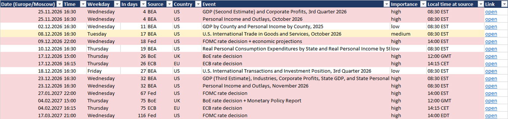

# 📅 Macro Calendar

[](https://github.com/ultra2sad/macro-calendar/actions/workflows/tests.yml)


Scrapes the dates that move markets — **central bank rate decisions and key US macro releases** — straight from the official websites, and turns them into:

- a **formatted Excel table** (your time zone, days left, colour by importance, filters), and
- an **.ics file** you import into Google Calendar / Outlook / Apple Calendar in one click.

Every rate decision on Polymarket, every volatile day in crypto and FX starts on one of these pages. Instead of trusting a third-party calendar, this reads the primary sources.



## Sources

| Source | What | Time (publisher's zone) |
|---|---|---|
| [Federal Reserve](https://www.federalreserve.gov/monetarypolicy/fomccalendars.htm) | FOMC rate decisions (★ with economic projections) | 2:00 pm New York |
| [European Central Bank](https://www.ecb.europa.eu/press/calendars/mgcgc/html/index.en.html) | Governing Council rate decisions | 14:15 Frankfurt |
| [Bank of England](https://www.bankofengland.co.uk/monetary-policy/upcoming-mpc-dates) | MPC decisions (+ Monetary Policy Report) | 12:00 London |
| [BEA](https://www.bea.gov/news/schedule) | GDP, Personal Income & Outlays (PCE inflation), trade | 8:30 am New York |

All four are official, publicly published schedules. Each page has its own layout, so each source has its own parser; they all produce the same `Event` shape.

## Quick start

```bash
pip install -r requirements.txt
python -m macro_calendar
# -> output/macro_calendar.xlsx and output/macro_calendar.ics
```

Options:

```bash
python -m macro_calendar --days 90 --tz Europe/London   # next 90 days, London time in Excel
python -m macro_calendar --sources fed,ecb               # only some sources
python -m macro_calendar --ics-min high                  # only rate decisions, GDP and PCE in the .ics
```

**Google Calendar:** Settings → Import & export → Import → pick `macro_calendar.ics`. Re-importing a fresh file updates events instead of duplicating them (stable `UID`s).

The exit code is `1` if any source failed, so a scheduler (cron, Windows Task Scheduler) can alert you.

## How it's built

```
macro_calendar/
  sources/        one module per website: URL + parse(html) -> list[Event]
    fed.py ecb.py boe.py bea.py
  models.py       Event: tz-aware time, source, title, importance
  collect.py      parallel download (httpx, async), retries, per-source error isolation
  export_excel.py openpyxl: styled table + "Sources" status sheet
  export_ics.py   RFC 5545 by hand: CRLF, escaping, 75-byte line folding
tests/fixtures/   real pages saved from each site
```

Design decisions:

- **Time zones are kept, not hard-coded.** A Fed decision is "14:00 New York", not "22:00 Moscow": the offset changes twice a year with daylight saving, and on different dates in the US and Europe. Events store the publisher's zone (`zoneinfo`) and convert only at export.
- **One broken site never breaks the run.** Each source is downloaded and parsed in isolation. A failure shows up in the log, in the Excel "Sources" sheet and in the exit code — never as a crash or a silently empty column.
- **A redesign is detected, not ignored.** A page that downloads fine but yields zero events is reported as "layout changed?".
- **Polite scraping.** One request per page per run, an honest `User-Agent`, retries with back-off only on server errors (5xx), never on 4xx.
- **Tested offline.** Parsers run against saved copies of the real pages, including the awkward rows: meetings spanning two months (`Apr/May 30-1`), notation votes, non-breaking spaces in dates, PM release times.

## Adding a source

Create `macro_calendar/sources/<name>.py` with a `URL`, a `parse(html) -> list[Event]` and `SOURCE = Source(...)`, list it in `sources/__init__.py`, save the page into `tests/fixtures/` and add a test. Nothing else changes.

## Tests

```bash
pip install -r requirements-dev.txt
pytest
```

## Limitations

- US CPI and jobs (BLS) are not included yet.
- BEA's page lists only the next few weeks of releases; central banks publish a year or more ahead.

## License

MIT
